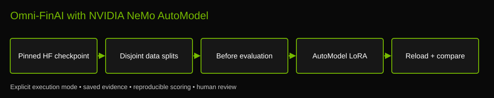

# Omni-FinAI with NVIDIA NeMo AutoModel

Download and run the original Omni-FinAI 70B checkpoint for financial extraction, numerical question answering, and summarization. Train small LoRA adapters with NeMo AutoModel, reload the exported adapter, and compare the same held-out examples before and after training.

[繁體中文快速入門](README.zh-TW.md) · [Playbook](docs/PLAYBOOK.md) · [Validation](VALIDATION.json) · [Sources and licenses](docs/SOURCES.md)



## Start with the offline tutorial

Use an independent Python environment for each repository: these teaching projects intentionally share the package name `project_demo`. Python 3.12 is recommended.

```bash
python -m venv .venv
# Linux/macOS: source .venv/bin/activate
# Windows: .venv\Scripts\activate
python -m pip install -e .
python -m project_demo prepare --output-dir runs/preparation
python -m project_demo demo --mode fixture --output-dir runs/fixture
python -m unittest discover -s tests -v
```

Fixture outputs are labelled authored examples. They validate the program and scoring rules; they are never presented as model execution. Every invocation writes a new run directory. Live failures remain failures, with error details and request-attempt accounting.

## Method and scope

The original profile selects the pinned 70B Omni-FinAI checkpoint. The small profile selects a different, explicitly labelled Qwen2.5 0.5B Instruct base for training mechanics. The authored financial reports use disjoint company IDs across training, validation, and test sets. AutoModel trains LoRA on training rows, validates separately, exports HF-compatible adapter weights, verifies nonzero LoRA-B updates, reloads them with PEFT, and scores the identical fixed test set.

This companion does not reproduce the paper training corpus, large-scale optimization, or benchmark results. It uses small synthetic financial reports with checkable arithmetic. The small profile is not Omni-FinAI. An optional NIM baseline is also labelled as a different model. A short LoRA run may reduce accuracy; the recorded result is retained.

Extraction checks every requested numeric field; QA checks the computed growth percentage. Summary scoring measures required numeric coverage only, not overall quality, faithfulness, or financial reasoning. Dataset and configuration hashes accompany each run.

## Tutorials

- [Interactive introduction](https://colab.research.google.com/github/virginiakm1988/omni-finai-nvidia/blob/v0.1.0/notebooks/01_interactive_demo.ipynb)
- [Evaluation and reproducibility](notebooks/02_evaluation.ipynb)

## Run the original checkpoint and AutoModel

Use the separate Taipei-1 Slurm recipes in the playbook; do not run GPU work on a login node.

```bash
# In a fresh environment for the original70B distributed run:
python -m pip install -r requirements-gpu-distributed.txt
python scripts/patch_automodel_0_7_triton.py
python -m pip install --no-deps -e .
export PYTHONNOUSERSITE=1
python -m project_demo demo --mode live --profile original --backend hf --output-dir runs/original
python -m project_demo train --mode live --profile original --gpus 4 --output-dir runs/lora-original
```

For the separate one-GPU Qwen tutorial, install `requirements-gpu-small-tested.txt` in its own fresh environment, apply the same documented patch, and run `train --mode live --profile small --gpus 1`.

The HF demo downloads the pinned checkpoint into the normal Hugging Face cache on first use. The optional `download --model-dir models` command exports a separate local copy; it does not redirect inference away from the cache, so use it only when you need that additional copy and have additional disk space.

The small Qwen teaching base is ungated. The gated Llama 3.2 attempt is retained in the validation history; it was not substituted within that failed run. The original checkpoint retains its upstream Llama license. The 70B profile checks free GPU memory and requires about 150 GiB free disk for downloading; allocate multiple H100 GPUs with adequate headroom. It is never transparently replaced with a smaller model. Training uses `nemo-automodel==0.7.0`; the official `nvcr.io/nvidia/nemo-automodel:26.10.00` image is another supported environment starting point. A compatible host driver remains required.

[AutoModel training tutorial](notebooks/03_automodel_lora.ipynb) records the recipe, training log, before/after predictions, fixed test hash, and exported adapter proof. A prepared recipe is labelled unexecuted until a real GPU run completes.

## Public references

- [Omni-FinAI 70B model](https://huggingface.co/ichanchiu/Llama-3.1-Omni-FinAI-70B)
- [Project paper / SSRN abstract 5004298](https://papers.ssrn.com/sol3/papers.cfm?abstract_id=5004298)
- [NeMo AutoModel](https://github.com/NVIDIA-NeMo/Automodel)
- [Official AutoModel SFT/PEFT guide](https://docs.nvidia.com/nemo/automodel/v0.7/recipes-e2e-examples/sft-peft)
- [Small teaching base: Qwen2.5 0.5B Instruct](https://huggingface.co/Qwen/Qwen2.5-0.5B-Instruct)

## Licensing and publication

New code and authored teaching data are Apache-2.0. Third-party models, source projects, and SDKs keep their own licenses. We do not redistribute their model weights. No organizational achievement or paper result is inferred from these small demonstrations. See [source notes](docs/SOURCES.md) for versions and method differences.

## Measured outputs

[Original Omni-FinAI 70B plain-prompt baseline](evidence/original-70b-inference.json) ran on four H100s: all three strict teaching checks failed, with repetitive or nonconforming output retained. [Separate Qwen 0.5B LoRA tutorial](evidence/automodel-small/result.json) completed twelve updates, saved/reloaded the adapter, and compared twelve held-out reports: extraction 0/4 → 4/4, numerical QA 0/4 → 0/4, summary numeric coverage 4/4 → 4/4. These small outcomes do not establish broad financial ability.

The standalone HF demo uses the checkpoint’s shipped chat template by default; `--prompt-format plain` reproduces the earlier plain-prompt baseline. AutoModel training and its before/after comparison use the same plain ColumnMapped prompt. The model card positions Omni-FinAI as a finance-pretrained foundation for further task adaptation.

[Actual shipped-chat-template validation](evidence/original-70b-chat-inference.json) used the same three inputs and pinned checkpoint. Strict checks also scored 0/3; the model card’s intended downstream adaptation remains necessary to assess for each task. The raw outputs and prompt format are retained.

[Original 70B actual AutoModel LoRA validation](evidence/automodel-original/result.json): Actual Taipei-1 Slurm job 14147 completed 12 NeMo AutoModel LoRA updates on 4 H100 GPUs, saved the adapter, verified 560 nonzero LoRA-B tensors, and reloaded it for the identical 12 held-out examples. Before: extract: 0/4; qa: 0/4; summary: 0/4. After: extract: 0/4; qa: 0/4; summary: 4/4. Total pipeline duration: 515.6 seconds. The training and before/after comparison use the same plain ColumnMapped prompt, not the separate chat-template demo. Summary scoring is numeric coverage only; these tiny authored results are not paper reproduction or proof of financial expertise. The complete tested distributed environment and documented upstream import patch are retained alongside the logs.

[Preserved failed attempts](evidence/failed-attempts/README.md) document gated access, SDK compatibility, and memory failures together with the explicit fixes. Successful execution is separate from task quality: repeated text and failed strict extraction/QA checks remain in the actual outputs.
